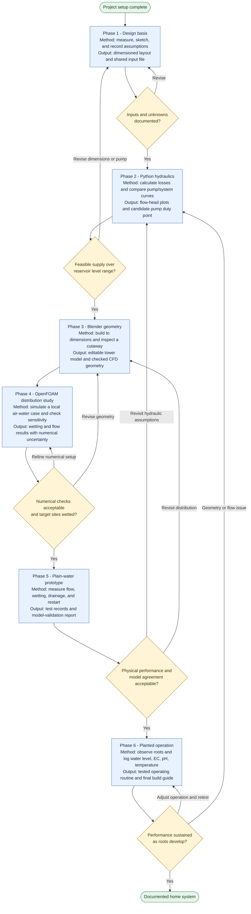

# Development phases: methodology and planned outputs

This is the development roadmap for one home hydroponic tower. Complete one phase at a time and review its outputs before advancing. Phase numbers match the detailed [workflow](WORKFLOW.md).

**Current status:** project setup complete; Phase 1 is next. All six development phases remain planned. No hydraulic or plant-performance results have been validated.

## Methodology flowchart

The final milestone is a planned outcome, not a claim that the system is already complete. Establish measurable acceptance criteria during Phase 1 and refine them explicitly as evidence becomes available; no flow target, uniformity tolerance, or watering interval is prescribed yet.

## Planned output by phase

| Phase | Methodology and learning focus | Planned outputs | Completion evidence |
| --- | --- | --- | --- |
| **1. Design basis** | Review the reference; measure or propose dimensions; identify crop, site, constraints, and unknowns. Separate assumptions from measurements. | Dimensioned schematic; completed inputs in `configs/tower.json`; assumption register; initial test criteria. | Required inputs have units and sources. Unresolved inputs and their impact are recorded. |
| **2. Python hydraulics** | Convert units; calculate static lift, friction and minor losses, and distributor head; intersect pump/system curves; examine high/low reservoir levels and blockage sensitivity. | Reusable Python calculations; system and pump plots; candidate duty point; sensitivity summary. | Calculation checks pass; actual pump-curve data supports the proposed operating range. Results remain predictions until Phase 5. |
| **3. Blender geometry** | Learn units, dimensions, repeated pockets, Python-driven geometry, and cutaways; check geometry before CFD export. | Editable `.blend` scene; cutaway views; dimension-checked fluid-domain export. | Model matches the shared inputs; units, boundaries, normals, and export quality are checked. |
| **4. OpenFOAM study** | Learn a simple tutorial, then model the distributor and representative pockets; check conservation, resolution, time step, and wall-wetting assumptions. | Versioned CFD case; boundary-condition notes; wetting/capture results; numerical sensitivity report. | Numerical checks are recorded and planting-site wetting is quantified. Physical validation is still pending. |
| **5. Plain-water prototype** | Build one tower; measure collected volume/time and site wetting; test drainage, shutdown, restart, low level, and partial obstruction. Compare observations with predictions. | Measurement CSVs; prototype photos; comparison plots; calibrated assumptions; revised build dimensions. | Measured performance meets the agreed criteria, and model discrepancies are explained or corrected. |
| **6. Planted operation** | Introduce a few plants; log reservoir level, EC, pH, and temperature; inspect changing root obstruction; establish an operating routine. | Growth and operation log; tested circulation/top-up routine; maintenance notes; final build guide and parts list. | Performance remains acceptable over the agreed observation period as roots develop; limitations are documented. |

## Water and control concept throughout development

One nutrient-water loop: **reservoir -> pump -> tower distributor -> planting sites -> gravity return -> reservoir**.

Fresh-water top-up replaces losses and is a separate decision from circulation timing. Start with manual level-based top-up, mix, then check EC and pH before nutrient correction. Any scheduled circulation remains a hypothesis to test; no pump off-time is approved by this roadmap. See [water-loop notes](WATER_LOOP.md).

## Working rhythm

1. Select the next incomplete phase.
2. Record inputs, assumptions, and the planned check before doing the work.
3. Work locally; save calculations, geometry, or measurements in the project folders.
4. Review the phase outputs, record findings in the [learning log](LEARNING_LOG.md), and update phase status.
5. Publish reviewed commits at the end of the working day when requested.

## Phase tracker

- [x] Project setup and development roadmap
- [ ] Phase 1 - Design basis
- [ ] Phase 2 - Python hydraulics
- [ ] Phase 3 - Blender geometry
- [ ] Phase 4 - OpenFOAM distribution study
- [ ] Phase 5 - Plain-water prototype and validation
- [ ] Phase 6 - Planted operation and final guide
