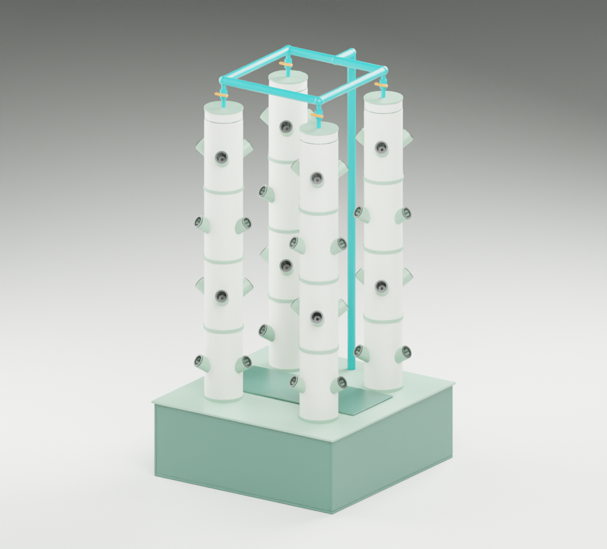

# Blender models

**Working design:** four stackable towers, one pump, a square supply loop connecting the tower tops, and the full-width shared reservoir. Use this version for the next round of measurements and pump sizing.

| Model | Blender file | Notes and previews |
| --- | --- | --- |
| **Selected: four towers with top loop and full-width tank** | [Download the working model](four-tower-top-loop/four_tower_top_loop.blend) | [Design notes](four-tower-top-loop/README.md) · [Top loop close-up](four-tower-top-loop/top_loop_detail.png) |
| Alternative: four towers with top loop and slide-out tank | [Download the service-base model](four-tower-service-base/four_tower_service_base.blend) | [Design notes](four-tower-service-base/README.md) · [Base close-up](four-tower-service-base/base_return_detail.png) |
| Earlier four-tower concept with a bottom manifold | [Download the bottom-manifold model](four-tower-unit/four_tower_unit.blend) | [Design notes](four-tower-unit/README.md) · [Manifold close-up](four-tower-unit/shared_manifold.png) |
| Single stackable tower | [Download the stackable model](concept-01/tower_concept.blend) | [Design notes and source credits](concept-01/README.md) |
| Single one-piece tower | [Download the one-piece model](concept-02/tower_concept.blend) | [Design notes](concept-02/README.md) · [Side-by-side comparison](concept-02/tower_options.png) |

## Open and edit

On GitHub, open a Blender file link and use **Download raw file**. In Blender 4.2 LTS or a compatible newer version, choose **File > Open** and select the downloaded `.blend`. Use the scene menu to switch between the assembly and detail views. **File > Save As** gives you an editable copy under your own filename.

The saved scenes include the model geometry and materials. To regenerate a model from dimensions, download or clone the whole repository because some generators reuse an earlier model in a sibling folder. Each design note explains which file to run and records the assumptions and source credits.

## Next working session

Use the selected full-width tank model to set the design flow per tower, estimate the total pump duty, and check the four branches for balance. The dimensions and operating water levels are still concept inputs.
